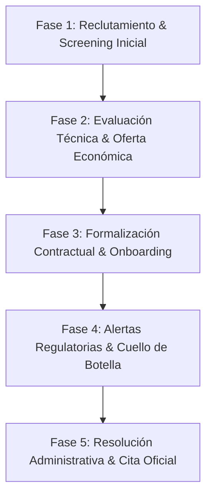

# Forensic Hiring Analytics & Compliance Audit

> **Auditoría documental forense, modelado econométrico y plataforma analítica interactiva** sobre un proceso de contratación de ingeniería senior en una corporación multinacional: +220 días de trazabilidad cronológica, matriz de riesgos de compliance y cuantificación de la depreciación salarial mediante datos oficiales de inflación.

---

## Resumen Ejecutivo

En procesos de contratación corporativa transnacional, la desconexión operativa entre sedes regionales y centros de servicios compartidos puede generar fricciones administrativas severas, riesgos regulatorios y un impacto económico medible sobre las partes involucradas.

Este proyecto constituye un **estudio de caso forense y una demostración avanzada de Analítica de Datos (Data Analytics)** aplicada a la gestión de talento, gobernanza corporativa y cumplimiento legal. A través de la reconstrucción documental de más de **90 comunicaciones formales**, la integración de **series macroeconómicas oficiales** y el modelado cuantitativo de pérdida de poder adquisitivo, se traduce un proceso administrativo complejo en un tablero interactivo de inteligencia de negocio.

> ℹ️ **Nota de Privacidad y Confidencialidad:** Por estrictas razones de reserva profesional, este repositorio público funciona exclusivamente como **pitch metodológico y caso de estudio analítico**. Se ha mantenido en total anonimato la identidad de las entidades corporativas y se ha omitido la publicación de código fuente interno, contratos privados y documentos probatorios de carácter reservado.

---

## Metricas Clave del Caso de Estudio

| Métrica Analítica | Valor Observado | Impacto en Negocio |
| :--- | :--- | :--- |
| **Dilación acumulada** | **+220 días** | Parálisis operativa e incertidumbre contractual precontractual. |
| **Comunicaciones auditadas** | **90+ registros** | Bitácora forense de correos, acuerdos y notificaciones formales. |
| **Fechas de ingreso fallidas** | **3 hitos** | Fricción por desalineación entre Talent Acquisition y People Ops. |
| **Banderas rojas clasificadas** | **8 anomalías** | Matriz de compliance con categorización de causa raíz y severidad. |
| **Fuente macroeconómica** | **API SIE (Banxico)** | Consumo en tiempo real del Índice Nacional de Precios al Consumidor (INPC). |
| **Tiempo de respuesta candidato** | **< 48 horas** | SLA promedio de cumplimiento documental y debida diligencia. |

---

## Analitica de Datos y Modelado Financiero

Uno de los pilares centrales del proyecto es la aplicación de técnicas cuantitativas y econométricas para evaluar el impacto financiero de la dilación patronal:

### Deflactación Salarial y Pérdida de Poder Adquisitivo

* **Cálculo de Salario Real:** Modelado matemático que indexa el salario nominal pactado frente a la evolución mensual de la inflación acumulada, determinando la brecha real de ingresos respecto al poder de compra de la fecha de oferta inicial.
* **Cuantificación del Costo de Oportunidad (Lucro Cesante):** Estimación agregada del impacto patrimonial acumulado por los meses de inactividad obligada, contrastado frente a la banda salarial de mercado para roles de *Senior Software Engineer II*.
* **Calculadora de Reajuste en Tiempo Real:** Algoritmo dinámico que computa el salario indexado necesario para restaurar el valor económico original del contrato frente a cualquier corte temporal.

### Integracion Macroeconomica y API Banxico

* **Consumo de API Oficial en Vivo:** Integración con la **API REST del Sistema de Información Económica (SIE) de Banco de México**, consultando la serie oficial `SP1` (INPC General).
* **Arquitectura Resiliente:** Mecanismo dual con almacenamiento en caché local (*fallback data*) validado para garantizar disponibilidad continua e independencia de cuotas de consumo externas.

### Visualización Avanzada sin Dependencias Pesadas

* **Curvas Suaves Cúbicas (Spline Bézier):** Algoritmo propio para el trazado matemático de trayectorias en SVG interactivo, permitiendo renderizar tendencias macroeconómicas continuas y fluidas sin sobrecargar el frontend con librerías pesadas.

---

## Mineria de Procesos y Trazabilidad Forense

El análisis aplica principios de *Process Mining* y auditoría forense para estructurar un historial desordenado de eventos en una línea de tiempo accionable:

* **Desglose de Eventos:** Cada hito cuenta con fecha, resumen fáctico, nivel de severidad (*Crítico*, *Alto*, *Medio*, *Positivo*) y actores intervinientes.
* **Filtros Multidimensionales:** Visualización segmentada por fases de contratación y tipología de evento (errores organizativos, acciones del candidato, hitos oficiales).
* **Mapeo Organizacional Transnacional:** Diagnóstico de brechas de comunicación entre la casa matriz (EE. UU.), centros de servicios compartidos (Brasil/Colombia) y la entidad empleadora local (México).

---

## Matriz de Riesgos y Red Flags

Se estructuró una matriz de debida diligencia (*due diligence*) corporativa que clasifica 8 irregularidades operativas detectadas a lo largo del proceso:

1. **Compromiso vinculante sin capacidad operativa:** Fijación de fechas de ingreso sin verificación previa de requisitos regulatorios locales.
2. **Transferencia improcedente de obligaciones patronales:** Solicitud errónea al candidato de trámites y constancias cuya titularidad corresponde exclusivamente a la empresa.
3. **Inconsistencia entre sedes corporativas:** Falta de gobernanza unificada entre reclutamiento internacional y recursos humanos locales.
4. **Falta de actualización documental:** Operación con registros corporativos no actualizados ante las autoridades competentes.
5. **Mitigación proactiva de infracciones:** Intervención oportuna del candidato que evitó la consumación de faltas administrativas y sanciones patronales.

---

## Arquitectura y Habilidades Demostradas

Este caso de estudio refleja competencias clave en la intersección de la ingeniería de software y la ciencia de datos:

* **Data Analytics & Econometría:** Modelado financiero, deflactación de series temporales, cálculos actuariales de costo de oportunidad y visualización cuantitativa en SVG.
* **Ingeniería de Datos & APIs:** Consumo e integración de APIs financieras públicas (Banxico SIE), esquemas de validación tipados y arquitectura desacoplada.
* **Process Mining & Business Intelligence:** Auditoría forense de procesos de negocio, detección de cuellos de botella y diseño de tableros de control ejecutivos.
* **Pensamiento Estratégico y Cumplimiento:** Análisis de gobernanza corporativa, gestión de riesgos legales y presentación ejecutiva basada en datos contrastables (*Data Storytelling*).

---

## Executive Summary (English)

This project presents a **forensic data analytics audit and corporate compliance case study** analyzing a senior engineering cross-border hiring workflow within an international enterprise.

### Key Capabilities Demonstrated

* **Quantitative Financial Modeling:** Deflated contracted compensation against official central bank time-series data (**Banxico SIE API**, `SP1` consumer price index), tracking purchasing power erosion and cumulative opportunity loss.
* **Interactive Data Visualization:** Custom cubic Spline Bézier mathematical curves rendered in native SVG, coupled with live recalculation tools.
* **Forensic Process Mining:** Reconstructed **+220 days** of timeline logs across **90+ verified communications**, identifying failure points and cross-border siloing between US headquarters, Latin American shared service centers, and local subsidiaries.
* **Corporate Risk Matrix:** Systematic classification of 8 governance red flags, assessing legal risk, root causes, and proactive compliance mitigation.

---

## Contacto y Referencias

* **Autor:** Nicolás Snider
* **LinkedIn:** [linkedin.com/in/nicolassnider](https://www.linkedin.com/in/nicolassnider/)
* **Portfolio:** [nicolassnider.github.io](https://nicolassnider.github.io)
* **GitHub:** [github.com/nicolassnider](https://github.com/nicolassnider)
